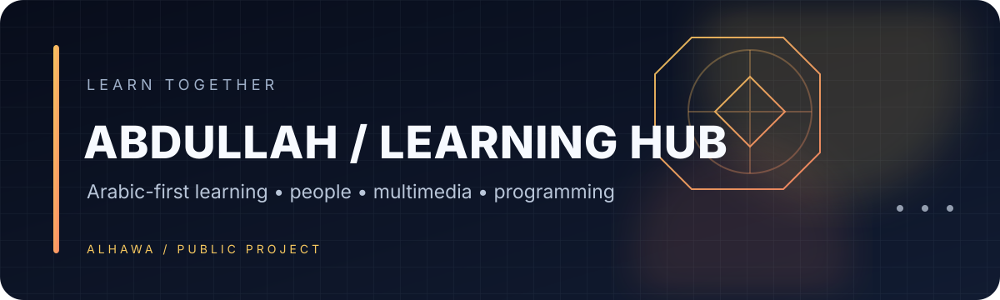

# Abdullah · Learning Hub

An Arabic-language multimedia learning project introducing programming concepts through people, examples, and web content.

## Project highlights
- Arabic-first page structure with right-to-left reading direction.
- Introductory sections for C++, Python, Java, and web development topics.
- Multimedia examples, including images, audio, video, and an embedded video.
- Supporting pages for project information, a CV link, and CSS demonstrations.

## Run locally
1. Clone or download this repository.
2. Open `index.html` in a modern browser.
3. Keep the media and supporting files beside the HTML files so their relative links continue to work.

## Main files
| File | Role |
|---|---|
| `index.html` | Main Arabic learning page |
| `Muhand.html` | About/project information page |
| `css_data_styles.html` | CSS examples |
| `main.pdf` | Linked CV document |

> This repository is a learning/demo website. Forms and sign-in interfaces should not be treated as production authentication.

---

<b>ALHAWA</b> · Learning is better when shared.

